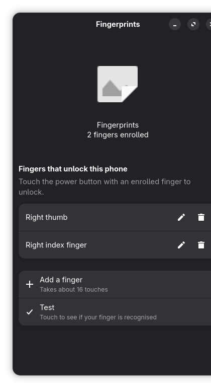

# Fingerprint in Settings and Phosh (FP5 / Nura)

Status 2026-10-23. Branch `fprint-integration` (on `resuspend` on `fprintd`).

## What exists on the phone
| piece | version | fingerprint support |
|---|---|---|
| GNOME Settings (`gnome-control-center`) | 51.0 | System -> Users has a "Fingerprint Login" row and an enroll/delete dialog (`cc-fingerprint-dialog`), talking to `net.reactivated.Fprint` |
| `phosh-mobile-settings` | 0.57.0 | none (no users/fingerprint page; it only has Phosh shell options) |
| Phosh / phoc | 0.57 | **no fprintd support at all** (checked source at master a3cded4: no "fprint" anywhere in `src/`). The lock screen only checks a PIN/password through PAM when it is submitted |
| fprintd API | `fp5-fprintd` (ours) | same names/objects as fprintd; polkit actions `net.reactivated.fprint.device.{verify,enroll,setusername}` installed (stock policy) |
| sudo / polkit prompts | | already use `pam_fprintd` (finger first while unlocked, then password) |

## GNOME Settings: what it needs, and what was missing
`panels/system/users/cc-user-page.c` (51.0) shows the Fingerprint row only if

1. the row is for the logged-in user (uid == getuid), and
2. GSettings schema `org.gnome.login-screen` exists and `enable-fingerprint-authentication` is true, and
3. fprintd answers `GetDevices` and the manager state is not NONE.

(1) and (3) were already fine. **(2) was the gap**: that schema ships with gdm,
which is not installed, so Settings hid the row. `scripts/fprint-integration/org.gnome.login-screen.gschema.xml`
is a one-key stand-in installed in `/usr/local/share/glib-2.0/schemas` (read before `/usr/share`, so a later
gdm package cannot conflict).

What Settings expects from the device, and what we answer (checked with `busctl` on the phone):

| Settings uses | ours |
|---|---|
| `Manager.GetDevices` -> `ao` | `[/net/reactivated/Fprint/Device/0]` |
| `Device.ListEnrolledFingers("")` | `right-index-finger`, `right-thumb`; `NoEnrolledPrints` when empty |
| property `name`, `scan-type`, `num-enroll-stages`, `finger-present`, `finger-needed` | `Fairphone 5 FocalTech FT9362 (QTEE)`, `press`, `16`, `false`, `false/true` while an op runs |
| `Claim`/`Release` | allowed for the user in the active session (polkit `verify`, allow_active). From a plain SSH shell it answers "Not authorized" - expected |
| `VerifyStart("any"/name)` + `VerifyStatus(result, done)`, `VerifyFingerSelected` | verify-match / verify-no-match / verify-retry-scan |
| `EnrollStart(name)` + `EnrollStatus` | enroll-stage-passed, enroll-retry-scan, enroll-completed, enroll-failed; `EnrollStart` needs polkit `enroll` (auth_self_keep: Phosh shows its password prompt) |
| `DeleteEnrolledFinger(s)`, `DeleteEnrolledFingers2` | storage backup, then remove; the last finger is refused |

Settings limits (by design in GNOME): the ten fixed finger names only, no rename, no per-finger info.
Opening the dialog starts a `VerifyStart` (touch highlights the matching finger), so the phone must be unlocked
(it is: you are looking at Settings). While locked, the unlock watcher owns the sensor and the daemon answers
`AlreadyInUse`.

## Fingerprints app (this branch)
`fprintd/ui/fp5_fingerprints.py`, installed as `~/.local/bin/fp5-fingerprints` + `org.fp5.Fingerprints.desktop`
(app grid name "Fingerprints"). GTK4 + libadwaita (1.10 on the phone), no extra packages.

- list of enrolled fingers; **rename** (which finger is this? swaps if the name is taken), **delete** (confirm, storage backup first)
- **add a finger** (pick a free finger, progress bar over `num-enroll-stages`, messages for retry/failed), **test** (touch, match / no match)
- talks only to `net.reactivated.Fprint` and the extension `org.fp5.Fprint.Manage` (`ListDetailed`, `RelabelFinger`);
  never opens the sensor or the storage itself. Errors are explained (busy while locked, not authorised, ...).

Why an app as well: the template names were a guess (the right thumb was never labelled by the user), Settings cannot
rename, and the old "Finger" app (`org.fp5.qtee`) opens the trustlet itself and fights the daemon/watcher.

Daemon extension (`fprintd/fp5_fprintd.py`): `org.fp5.Fprint.Manage.RelabelFinger(old,new)` only edits
`/var/lib/fp5-qtee/fingers.json` (copy saved to `/var/lib/fp5-qtee/backup/fingers-<ts>.json` first, needs polkit `enroll`);
`ListDetailed(user)` returns `(finger, fid, source)`. Stock clients never call it.

## Lock screen
Phosh cannot use fprintd today. What exists: the unlock watcher owns the sensor while locked (warm session + touch-to-wake),
gives haptic feedback through feedbackd, and shows transient notifications ("try again", lockout 30 s after 5 misses, PIN only after 20).
Those notifications appear on the lock screen only if Phosh is set to show notifications there.

A Phosh-native lock screen would need: (a) a Phosh change (Phosh has `PhoshLockscreen::unlock_submit`, `lockscreen-unlock`,
`phosh_lockscreen_set_unlock_status` and an extra-page extension point, but nothing calls fprintd) and (b) our daemon to
become the owner of the sensor while locked too (warm session, touch-to-wake wakeup, lockout policy move from the
watcher into the daemon). That is a big change with a risk of breaking unlock; recommendation: keep the watcher as the
lock-screen owner. The lockout state is now on D-Bus (branch `fprint-lockout`, `docs/fprint-lockout.md`), so a small Phosh plugin could show it.

## Deploy / restore (no reboot, no fingerprint storage touched)
    sh ~/fp5-qtee-keep/fprint-integration-20261023/deploy.sh    # schema shim, app, daemon with RelabelFinger
    sh ~/fp5-qtee-keep/fprint-integration-20261023/restore.sh   # removes shim and app, old daemon back

## Tests
    cd fprintd && python3 -m unittest test_fp5_fprintd
    cd fprintd && dbus-run-session -- python3 -m unittest test_fp5_fprintd_dbus
    gtk4-broadwayd :5 &  cd fprintd/ui && BROADWAY_DISPLAY=:5 GDK_BACKEND=broadway dbus-run-session -- python3 test_ui.py

## For the user to test (needs a finger; nothing here was run with one)
1. Settings -> System -> Users: row "Fingerprint Login" (Enabled). Open it: touch an enrolled finger, its row should light up.
2. Fingerprints app: test a finger; rename the right thumb to what it really is; add a finger; delete the test finger again.
   Before the first enroll/delete the daemon backs up `/mnt/persist/misc` (and fingers.json before a rename).
